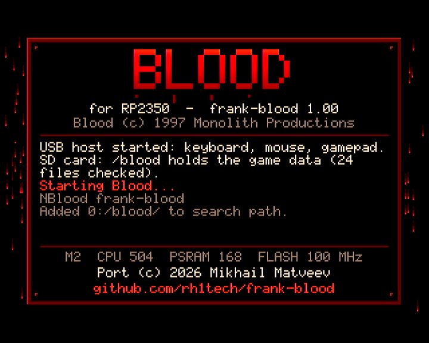
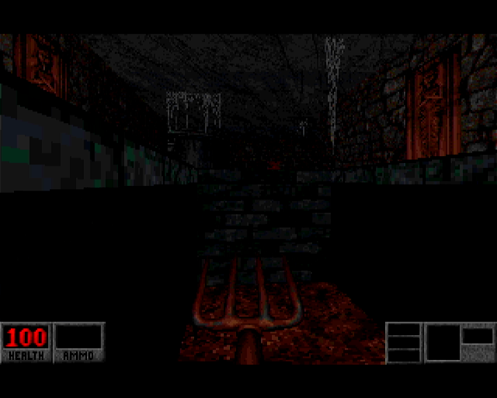
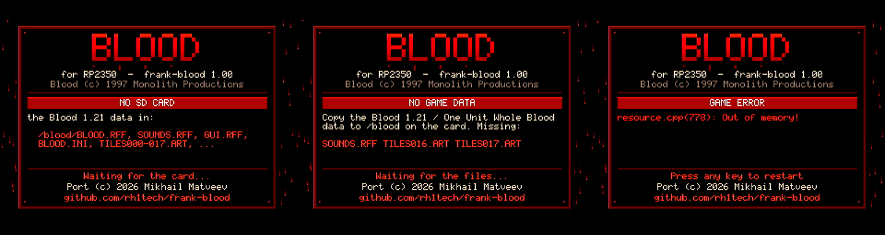

# frank-blood

Blood, Monolith's 1997 shooter, running on a single RP2350. It plays on the
[FRANK](https://rh1.tech/projects/frank) Core 2 (on its master chip) and on
the [Murmulator](https://murmulator.ru) / FRANK M2, with HDMI video, sound
effects and FM music, and the game data on a microSD card.




The game code is [NBlood](https://github.com/NBlood/NBlood), a
reverse-engineered Blood, in its Amiga flavour: BSzili's
[NBlood-Amiga](https://github.com/BSzili/NBlood-Amiga), which moved NBlood
from EDuke32 back onto Jonathon Fowler's
[JFBuild](https://github.com/jonof/jfbuild) and its classic software
renderer. That makes it small
enough for a microcontroller with 520 KB of SRAM and 8 MB of PSRAM.

- 320x200 8-bit software rendering, shown doubled on 640x480 at 60 Hz HDMI
- the whole game on one chip: core 0 runs the game and the renderer, core 1
  the HDMI output, the sound mixer and the music
- sound effects at 49.7 kHz on the board's I2S DAC
- music played the way the DOS game did on an Adlib: Apogee's FM driver and
  General MIDI timbre bank on an emulated OPL2
- USB keyboard, mouse and gamepad on the board's USB host port
- a welcome screen at power-on, and clear error screens for a missing card,
  missing game data or a fatal game error
- single player only

## Speed

Measured on the FRANK Core 2 with sound and music on, playing the four
attract demos without the menu over them:

| Demo | Real time | Fixed-tick benchmark |
|---|---|---|
| E1M1 | ~105 fps | 80 fps |
| E3M2 | ~112 fps | 78 fps |
| E2M1 | ~101 fps | 77 fps |
| E1M5 | ~78 fps | 65 fps |

The fixed-tick column gives every drawn frame 1/30 s of game time, so each
run draws exactly the same frames; it is the number used to compare builds.
HDMI stays at 60 Hz either way. The M2 runs at about the same speed.

## Boards

| | FRANK Core 2 | Murmulator / FRANK M2 |
|---|---|---|
| Chip | RP2350B (the master) | RP2350A or RP2350B |
| HDMI | GPIO 12-19 (HSTX) | GPIO 12-19 (HSTX) |
| I2S DAC | data 9, BCLK 10, LRCK 11 | data 9, BCLK 10, LRCK 11 |
| microSD (SPI0) | SCK 6, MOSI 7, MISO 4, CS 5 | SCK 6, MOSI 7, MISO 4, CS 5 |
| PSRAM | 8 MB, CS 47, 126 MHz | 8 MB, CS 8 (A) or 47 (B), 168 MHz |
| Debug UART | TX 0, RX 1 | TX 0, RX 1 |

The firmware finds the PSRAM chip select by itself from the chip's package.
The Core 2's second chip, the slave, is not used.

## Installing

1. Take the firmware for your board from the release:
   `core2_frank-blood_A_BB.uf2` (flash it to the Core 2's master chip) or
   `m2_frank-blood_A_BB.uf2`. Hold BOOTSEL, plug the board in and copy the
   file to the RP2350 drive, or use `picotool load -f FILE.uf2`.
2. Put the Blood 1.21 data (the "One Unit Whole Blood" release, also part of
   Blood: Fresh Supply) into `/blood` on a FAT32 or exFAT card:

   ```
   /blood/BLOOD.INI       /blood/SURFACE.DAT
   /blood/BLOOD.RFF       /blood/VOXEL.DAT
   /blood/GUI.RFF         /blood/TILES000.ART ... TILES017.ART
   /blood/SOUNDS.RFF
   ```

   `TABLES.DAT` is read when it is there. The `BLOOD000.DEM`-`BLOOD003.DEM`
   demos play behind the main menu. The four v1.00 demos play as well,
   though under 1.21's rules they wander off their recorded path.
3. Power the board on.

No game data comes with this project. If you have the game installed,
`python3 tools/pack_data.py <game folder>` makes `build/blood-data.zip` with
just the files above, ready to unzip onto the card. Add `--extras` for the
demos and Cryptic Passage.

When something is wrong, the welcome screen turns into an error screen:

| Screen | When | What happens |
|---|---|---|
| NO SD CARD | no card in the slot | waits for one |
| NO GAME DATA | files missing from `/blood` | lists them, waits for a card that has them |
| GAME ERROR | the game stopped with a fatal error | shows its message; any key restarts |



Quitting from the game's menu restarts the board.

### Options

An optional `/blood/frank.cfg` takes one `key=value` per line:

| Key | Meaning |
|---|---|
| `demomenu=0` | attract demos without the main menu over them |
| `ticks=4` | fixed game time per drawn frame (for benchmarks) |
| `mix=3` | sound: bit 0 effects, bit 1 music |
| `crc=1` | print a CRC of every drawn frame on the debug UART |
| `memlog=1` | log the heap, sound arena and resource cache every 10 s |

The game's own settings and saves go to `/blood` as well.

## Building

You need the Pico SDK 2.2, the Arm GNU toolchain, CMake and Ninja.

```sh
./build.sh                       # Core 2, into build/master
cmake -S master -B build/m2 -G Ninja -DCMAKE_BUILD_TYPE=Release -DFRANK_BOARD=M2
cmake --build build/m2           # M2
tools/flash.sh master build/master/frank-blood-master.elf   # over SWD
./release.sh [A.BB] [--publish]  # both UF2s into release/ (+ a GitHub release)
```

`version.txt` holds the version; `release.sh` asks for the next one and
updates it. After cloning, run `tools/install-hooks.sh` once to set up this
repository's git hooks.

The debug console is UART0 at 115200. It takes commands while the game
runs: `help` lists them (frame rate, memory, sound, microSD checks, key
presses and more). DEV.md covers the memory map, the benchmark, profiling
and the Mac build of the game used as a reference.

## Credits

Blood
- **[Monolith Productions](https://www.lith.com)**: Blood (1997)
- **Ken Silverman**: the [Build engine](http://advsys.net/ken/build.htm)

The game code
- **Alexey "Nuke.YKT" Khokholov** and the NBlood contributors:
  [NBlood](https://github.com/NBlood/NBlood), the reverse-engineered Blood,
  and [Blood-RE](https://github.com/NBlood/Blood-RE)
- **The [EDuke32](https://www.eduke32.com) team**: the engine work NBlood
  started from
- **Szilárd "BSzili" Biró**: [NBlood-Amiga](https://github.com/BSzili/NBlood-Amiga),
  NBlood on [JFBuild](https://github.com/BSzili/jfbuild/tree/amiga)
- **Jonathon Fowler**: [JFBuild](https://github.com/jonof/jfbuild),
  [JFAudioLib](https://github.com/jonof/jfaudiolib),
  [JFMACT](https://github.com/jonof/jfmact)
- **James R. Dose / Apogee Software**: the Apogee Sound System and the AL_MIDI
  FM driver with its General MIDI timbre bank, here by way of
  [Chocolate Blood](https://github.com/NBlood/chocolate-blood)
- **Greg Kennedy**: [libsmacker](https://github.com/greg-kennedy/libsmacker)

Libraries and drivers
- **Mitsutaka Okazaki**: [emu8950](https://github.com/digital-sound-antiques/emu8950),
  the OPL emulator; **Graham Sanderson**: its RP2040 version, from
  [rp2040-doom](https://github.com/kilograham/rp2040-doom)
- **Raspberry Pi Ltd**: the [Pico SDK](https://github.com/raspberrypi/pico-sdk)
  and the I2S PIO program from [pico-extras](https://github.com/raspberrypi/pico-extras)
- **Ha Thach**: [TinyUSB](https://github.com/hathach/tinyusb)
- **Ryan Wendland**: the Xbox controller driver, from [usb64](https://github.com/Ryzee119/usb64)
- **ChaN**: [FatFs](http://elm-chan.org/fsw/ff/)
- **Elehobica**: the microSD SPI driver, from [pico_fatfs](https://github.com/elehobica/pico_fatfs)
- **fboldog**: the HDMI data island encoder, from
  [rp2350-amiga](https://github.com/fboldog/rp2350-amiga)

RP2350 port
- **Mikhail Matveev** ([rh1.tech](https://rh1.tech), xtreme@rh1.tech): the
  port to RP2350, the board support (from
  [frank-amiga](https://github.com/rh1tech/frank-amiga)), the boot shell
  (from [frank-quake2](https://github.com/rh1tech/frank-quake2)), the sound
  and music drivers and the speed work. Sister port:
  [frank-duke3d](https://github.com/rh1tech/frank-duke3d).

## License

frank-blood is released under the GNU General Public License, version 2
(see `LICENSE`). The Blood code from NBlood is GPL-2.0 only, which sets the
licence of the whole.

- The project's own code (`master/`, `common/`, `tools/`) is
  Copyright (c) 2026 Mikhail Matveev ([rh1.tech](https://rh1.tech)),
  GPL-2.0-or-later.
- The Build engine is covered by Ken Silverman's licence
  (`third_party/nblood-amiga/jfbuild/buildlic.txt`), which allows
  non-commercial use only.
- The other parts keep the licences in their headers: GPL-2.0-or-later
  (JFAudioLib, JFMACT, AL_MIDI), LGPL-2.1 (libsmacker), MIT (emu8950,
  TinyUSB code, the usb64 driver), BSD (FatFs, the microSD driver, the Pico
  SDK and its PIO programs) and MPL-2.0 (the HDMI data island encoder).

Blood and its data belong to their owners. Nothing from the game is
included; you need your own copy.
